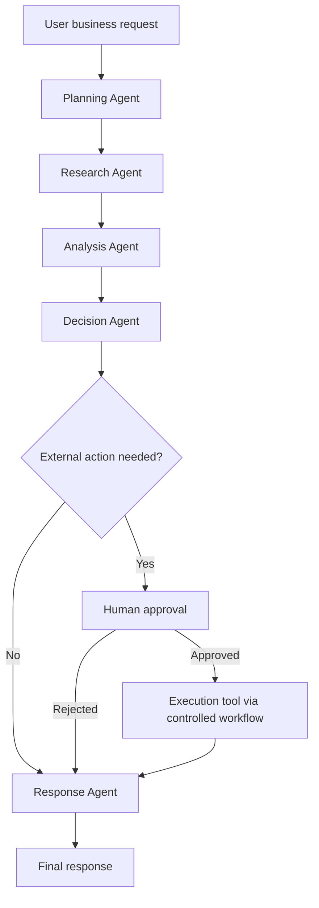

# Agent Architecture

## 1. Purpose
This document describes the purpose, inputs, outputs and ownership of the agents and supporting components in the AI Agent Coordination & Decision Engine.

## 2. Agent execution model
The LangGraph Orchestrator controls the workflow. Agents receive a defined task and context, perform their assigned responsibility, and return structured results. The orchestrator decides which component runs next.

## 3. Agent responsibilities

### Planning Agent — M4
**Purpose:** Understand the business request and create a structured plan.

Responsibilities:
1. Receive the user's business request.
2. Identify the objective.
3. Divide the request into smaller tasks.
4. Identify which agents/tools are needed.
5. Define the order of execution.
6. Produce a structured task plan.
7. Return the plan to the orchestrator.

Expected output: task list, task dependencies/order and required agent names. The exact schema must follow `../standards/agent_contracts.md`.

### Research Agent — M4
**Purpose:** Collect relevant information for the planned tasks.

Responsibilities:
1. Receive research tasks from the Planning Agent or Orchestrator.
2. Identify required information.
3. Select relevant tools.
4. Retrieve information from databases or external sources.
5. Organize the retrieved information.
6. Return structured research results.
7. Identify missing or incomplete information.

Expected output: findings, source/evidence details where available, data gaps and limitations.

### Analysis Agent — M5
**Purpose:** Analyse collected information and identify meaningful findings.

Responsibilities:
1. Receive structured research results.
2. Check whether the information is sufficient for analysis.
3. Perform comparisons and calculations.
4. Identify patterns, risks and important findings.
5. Explain assumptions and limitations.
6. Return structured analysis results.

Numerical comparisons, thresholds and rankings should use deterministic Python calculations where appropriate rather than relying only on LLM-generated numbers.

### Decision Agent — M5
**Purpose:** Evaluate options and recommend an appropriate course of action.

Responsibilities:
1. Receive analysis findings.
2. Identify possible options.
3. Compare options against stated criteria.
4. Consider trade-offs, risks and uncertainty.
5. Produce an explained recommendation.
6. Identify whether human approval is needed before an external action.

The agent should explain its recommendation; it must not blindly select an option.

### Response Agent — M2
**Purpose:** Turn workflow outputs into a clear response for the user.

Responsibilities:
1. Receive the relevant workflow results.
2. Prepare a clear and structured response.
3. Include recommendations, reasoning and caveats.
4. Avoid claiming that an action succeeded unless the execution result confirms it.
5. Return the response to the orchestrator/backend for display.

## 4. Supporting components

### LLM / Base Agent — M2
Provides reusable model configuration, prompt templates, response generation and common error handling for specialized agents.

### Tools and Tool Registry — M3
The project specification identifies:
- Database Tool — retrieve business records.
- Search Tool — retrieve relevant external information.
- Calculation Tool — perform calculations.
- API Tool — connect with external services.
- Tool Registry — make tools discoverable to agents.

Tools should return structured data, not an unverified natural-language answer.

### Memory — M6
- Short-term memory: current conversation and workflow context.
- Long-term memory: useful information for future workflows.
- Shared memory: relevant outputs from planning, research, analysis and decisions.

### Orchestrator — M7
Registers and invokes agents, manages state, routes results, handles conditional execution and failure paths, and tracks workflow progress.

## 5. Agent interaction rules
1. All agent calls are initiated and routed by the orchestrator.
2. Each agent follows the common input/output contract.
3. Each output identifies its task and agent.
4. Status and error information must be explicit.
5. Agents must report missing data rather than inventing it.
6. External actions must go through approved tools and controlled workflow logic.
7. Human approval is required before consequential external actions where applicable.

## 6. Agent ownership summary
| Agent/component | Member |
|---|---|
| LLM / Base Agent and Response Agent | M2 |
| Tools / Tool Registry | M3 |
| Planning Agent and Research Agent | M4 |
| Analysis Agent and Decision Agent | M5 |
| Memory | M6 |
| Orchestrator and workflow | M7 |
