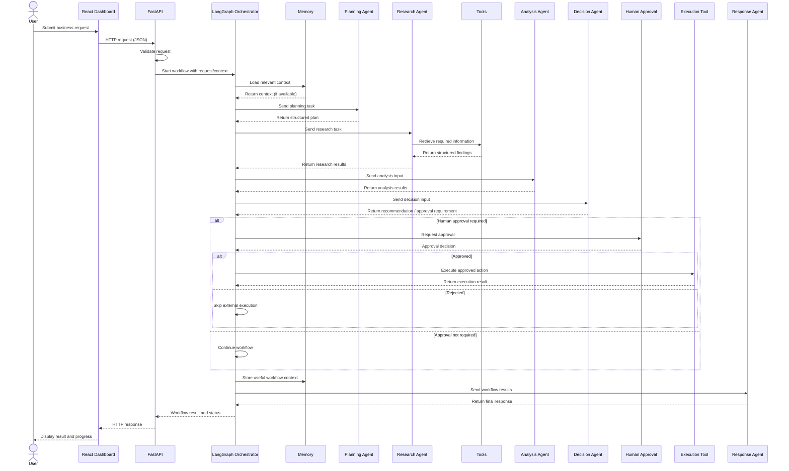

# Data Flow

## 1. Purpose

This document explains how a business request moves through the dashboard, backend, orchestrator, agents, tools, memory and final response.

It defines the communication sequence between system components, including human approval, controlled execution, error handling and workflow result delivery.

## 2. End-to-end flow

## 3. Step-by-step data movement

1. **Request:** User enters a business request in the React dashboard.

2. **API validation:** FastAPI validates the incoming request against the agreed common schema.

3. **Workflow creation:** The backend passes the request and relevant context to the LangGraph orchestrator.

4. **Context retrieval:** The workflow retrieves relevant prior context from memory when available.

5. **Planning:** Planning Agent breaks the request into smaller tasks and identifies the required work.

6. **Research:** Research Agent uses approved tools and external services to collect relevant information.

7. **Analysis:** Analysis Agent evaluates the collected information and produces structured findings.

8. **Decision:** Decision Agent compares available options and produces an explained recommendation.

9. **Human approval:** If a consequential external action is required, the workflow requests human approval before execution.

10. **Controlled execution:** If approval is granted, the orchestrator invokes the appropriate controlled execution tool. If approval is rejected, the external action is skipped.

11. **Persistence:** Relevant workflow state and useful results are stored using the agreed persistence and memory design.

12. **Response generation:** Response Agent formats the workflow results into a clear user-facing response.

13. **Display:** The backend returns the workflow status and final result to the React dashboard.

## 4. Common data rules

- Use JSON for component and API communication.
- Follow the shared contracts defined in `../standards/agent_contracts.md`.
- Preserve `task_id` when passing the same task between components.
- Use `workflow_id` to identify an overall workflow.
- Use explicit status values and structured error information.
- Do not place secrets or credentials in request context.
- Include evidence and source details in research results when available.
- Do not treat missing information as a confirmed fact.
- Validate inputs and outputs at component boundaries.
- The orchestrator controls actual agent execution and routing.
- Consequential external actions must follow the human approval process.

## 5. Failure and recovery flow

- **Request validation failure:** If request validation fails, the API returns a validation error and does not start the workflow.

- **Agent failure:** If an agent fails, the orchestrator records the failure and follows the agreed retry or failure policy.

- **Tool failure:** If a tool times out or an external source is unavailable, return a structured error or partial result.

- **Missing research data:** If required research data is missing, the workflow flags the gap rather than fabricating findings.

- **Approval rejected:** If human approval is rejected, the consequential external action must not execute. The workflow records the rejection and returns the appropriate status.

- **Execution failure:** If an approved external action fails during execution, the workflow records the execution error and returns the appropriate failure or partial-result status.

- **Dashboard failure states:** The dashboard should display loading, completed, failed and unavailable states.

## 6. Data-flow ownership

- **M1:** Documents and coordinates the cross-component architecture, common interfaces and integration flow.
- **M2:** Owns LLM integration, base agent and response generation.
- **M3:** Owns custom tools, database retrieval and external service integrations.
- **M4:** Owns planning and research agents.
- **M5:** Owns analysis and decision agents.
- **M6:** Owns the remaining assigned project component as defined in the team responsibility allocation.
- **M7:** Owns orchestration and backend API implementation, including the shared API schemas.
- **M8:** Owns the remaining assigned project component as defined in the team responsibility allocation.

Each member implements their assigned component while following the agreed common contracts.

## 7. Integration requirements

1. All agents must follow the approved common input and output contracts.
2. Components must exchange structured JSON-compatible data.
3. The orchestrator must control agent execution and workflow transitions.
4. Tool integrations must return structured results and errors.
5. Human approval must be obtained before consequential external actions.
6. All components must preserve task and workflow identifiers.
7. Contract changes must be discussed and approved before implementation.
8. Integration changes must be reviewed through GitHub pull requests.
9. System-level testing must verify the complete request-to-response flow.

## 8. Testing expectations

The integrated system should be tested for:

- Successful business request processing.
- Correct request validation.
- Correct agent execution sequence.
- Successful information retrieval.
- Correct structured agent communication.
- Correct workflow state management.
- Human approval granted and rejected scenarios.
- Controlled execution success and failure.
- Agent and tool failure recovery.
- Memory retrieval and persistence.
- Correct final response delivery to the dashboard.

## 9. Document maintenance

This document is maintained by M1 as part of the shared system architecture documentation.

Any change to the data flow, agent communication, orchestration or integration process must be reviewed with the relevant module owners before implementation.

The common contracts in `../standards/agent_contracts.md` remain the reference for shared communication formats.
