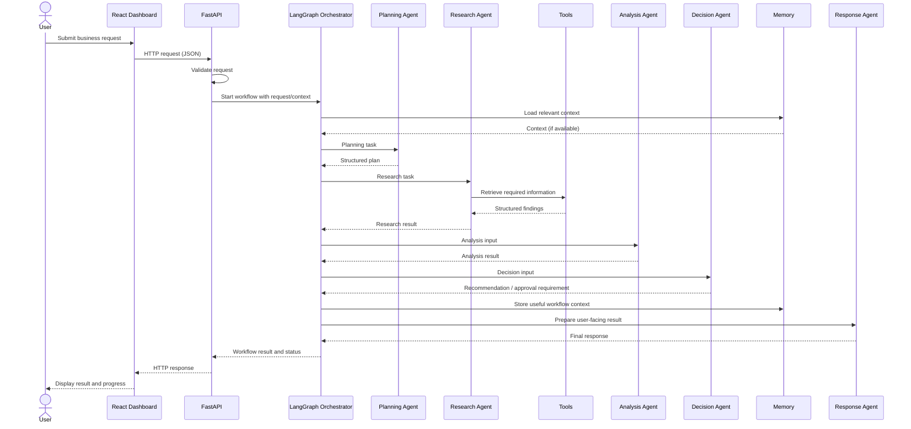

# Data Flow

## 1. Purpose
This document explains how a business request moves through the dashboard, backend, orchestrator, agents, tools, memory and final response.

## 2. End-to-end flow

## 3. Step-by-step data movement
1. **Request:** User enters a business request in the React dashboard.
2. **API validation:** FastAPI validates the request against the agreed schema.
3. **Workflow creation:** The backend passes the request and context to the orchestrator.
4. **Context retrieval:** The workflow may retrieve relevant prior context from memory.
5. **Planning:** Planning Agent breaks the request into tasks and identifies required work.
6. **Research:** Research Agent uses approved tools to collect information.
7. **Analysis:** Analysis Agent evaluates the collected information.
8. **Decision:** Decision Agent compares options and creates an explained recommendation.
9. **Approval/execution:** If a consequential external action is required, the workflow pauses for human approval before invoking the controlled execution tool.
10. **Response:** Response Agent formats the result.
11. **Persistence:** Relevant workflow state/results are stored using the agreed persistence and memory design.
12. **Display:** Backend returns status and result; dashboard displays them.

## 4. Common data rules
- Use JSON for component/API communication.
- Use the shared contracts in `../standards/agent_contracts.md`.
- Preserve `task_id` when passing the same task between components.
- Use `workflow_id` to identify an overall workflow.
- Use explicit status values and structured error information.
- Do not place secrets or credentials in request context.
- Include evidence/source details in research results when available.
- Do not treat missing information as a confirmed fact.

## 5. Failure and recovery flow
- If request validation fails, the API returns a validation error and does not start the workflow.
- If an agent fails, the orchestrator records the failure and follows its agreed retry/failure policy.
- If a tool times out or an external source is unavailable, return a structured error or partial result.
- If required research data is missing, the workflow should flag the gap rather than fabricate findings.
- If human approval is rejected, do not execute the consequential action; return the decision and status.
- The dashboard should show loading, completed, failed and unavailable states.

## 6. Data-flow ownership
M1 documents and coordinates the cross-component flow. M2–M8 implement their owned components. M7 owns the orchestration and backend paths that connect the components.
