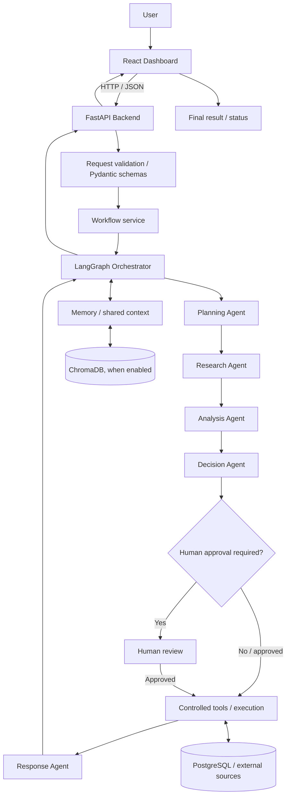

# System Architecture

## 1. Purpose
This document describes the high-level architecture of the AI Agent Coordination & Decision Engine. It gives all team members a shared view of the system and defines component boundaries for integration.

## 2. Project objective
Build an enterprise-oriented platform in which specialized AI agents collaborate to understand a business request, gather information, analyse it, evaluate options and return a recommendation through a dashboard.

## 3. Proposed technology stack
| Area | Proposed technology | Responsibility |
|---|---|---|
| Language | Python | Backend and agent modules |
| LLM integration | LangChain / provider API | Model access and prompt support |
| Orchestration | LangGraph | Shared state, routing and workflow execution |
| Backend API | FastAPI | HTTP endpoints and request validation |
| Validation | Pydantic | Structured request and response validation |
| Relational storage | PostgreSQL | Workflow metadata and business/application records |
| Vector store | ChromaDB | Long-term semantic memory, when introduced |
| Frontend | React | User dashboard |
| Testing | pytest; Postman; browser testing | Component, API and UI verification |
| Deployment | AWS (proposed) | Hosting, subject to team/mentor approval |

The stack is proposed in the project specification. Confirm exact versions, model provider and infrastructure choices as a team. Do not provision paid services without approval.

## 4. High-level architecture

## 5. Main components and boundaries

### React dashboard
- Collects the user's business request.
- Displays workflow status and agent progress.
- Displays the final result, recommendations and workflow history.
- Calls the backend through HTTP/JSON; it must not call internal agents directly.

### FastAPI backend
- Exposes application endpoints.
- Validates incoming requests and returns structured responses.
- Passes valid workflow requests to the workflow/orchestration layer.
- M7 owns backend API implementation.

### LangGraph orchestrator
- Maintains shared workflow state.
- Selects and invokes agents in the agreed order.
- Routes outputs to the next step.
- Handles conditional paths and failed execution.
- M7 owns orchestration implementation; M1 coordinates integration.

### Specialized agents
- Planning Agent: decomposes the user's request into tasks.
- Research Agent: obtains and structures relevant information.
- Analysis Agent: analyses evidence and compares options.
- Decision Agent: evaluates options and prepares recommendations.
- Response Agent: formats the final response.
- Each agent is implemented by its assigned member.

### Tools and external services
- Database tool retrieves business records.
- Search tool retrieves relevant external information.
- Calculation tool performs calculations.
- API tool connects to external services.
- Tool Registry makes tools discoverable.
- M3 owns custom tools, validation and tool execution.

### Memory and persistence
- Short-term memory holds current conversation/workflow context.
- Long-term memory retrieves useful information for future workflows.
- Shared memory makes relevant outputs available to agents.
- M6 owns memory implementation. PostgreSQL stores persistent metadata; ChromaDB is proposed for vector retrieval.

## 6. Key architecture principles
1. Keep each member's module independently testable.
2. Use documented, structured input and output contracts.
3. Route agent execution through the orchestrator; agents must not create uncontrolled execution chains.
4. Validate data at component boundaries.
5. Keep external actions controlled. Require human approval before consequential external actions where applicable.
6. Use deterministic Python calculations for numerical comparisons where appropriate; use an LLM for interpretation and explanation.
7. Use mock implementations when a dependency is not ready so integration can continue.
8. Keep credentials and secrets outside source control.

## 7. Ownership boundaries
| Component | Owner |
|---|---|
| `docs/` and architecture/contracts coordination | M1 |
| LLM configuration, base agent and response generation | M2 |
| Tools and external services | M3 |
| Planning and Research agents | M4 |
| Analysis and Decision agents | M5 |
| Memory and knowledge management | M6 |
| Orchestration, workflow automation and backend API | M7 |
| Frontend dashboard and AWS deployment coordination | M8 |

The detailed ownership map is in `../planning/member_responsibilities.md`.

## 8. Assumptions and open decisions
- The project specification proposes the stack; the team must confirm final versions and providers.
- M1 and M7 must agree the final Pydantic contracts before implementation.
- ChromaDB is introduced after the basic memory interface works.
- AWS deployment is subject to approval and cost review.
- The exact API endpoint paths and status codes must be confirmed by M7 and documented before frontend integration.
